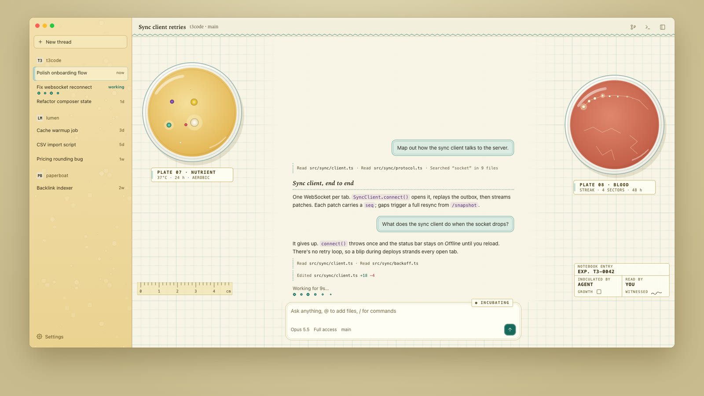

# Agar

**A lab-culture theme for [T3 Code](https://t3.codes).** Notebook paper, amber agar and petri plates in the margins. While your agent works, colonies grow outward across the plates. They grow once and hold, however long the turn runs, and when it ends a GROWTH CHECKED tab stamps onto the composer.

**[See it in motion →](https://joshsaintjacque.github.io/t3code-theme-agar/)**



## Install

**From the app**

1. Download [`agar.json`](agar.json), or copy its contents.
2. In T3 Code, open **Settings › Appearance › Add theme**.
3. Choose the file, or paste the JSON, and add it.

**From the terminal**

```sh
curl -fsSL -o agar.json https://joshsaintjacque.github.io/t3code-theme-agar/agar.json
~/.t3/bin/t3 theme set agar.json
```

`t3 theme set` publishes the file and sets it as the environment theme, so every client connected to that environment switches to it.

Tested on T3 Code 0.1.11 (nightly).

## What moves, and when

Every animation is tied to real app state. If nothing is running, nothing moves.

| | |
|---|---|
| **Petri plates** | On wide windows each gutter holds a plate. During a turn, colonies grow in once, one after another over about 30 s: scattered on nutrient agar, along a four-sector streak on blood agar. A few late satellites appear on long turns, then everything holds, so a long turn never wipes the plate. Between turns you see the finished plates, perfectly still. |
| **Inoculation streak** | A thin teal zigzag drifts slowly along the header rail while the turn runs. |
| **Busy threads** | A thread with an agent on it sprouts four colonies along its lower edge. The live *Working…* row grows six. |
| **Hover** | One red colony seeds under the pointer, ringed like a picked colony. |
| **Composer** | A double petri rim that lights teal on focus. A lab tab on its edge reads INCUBATING during a turn; when the turn ends, GROWTH CHECKED stamps down. |
| **Narrow windows** | No room beside the chat? Plate 07 docks small at the foot of the sidebar, under a scrim so it never competes with thread names. |

`prefers-reduced-motion` is respected throughout: plates show every colony, dots are grown, nothing animates.

## Palette

Paper and sepia ink do the reading, agar frames the sidebar, and teal is the only accent. The colony hues (cream, yellow, serratia red, violet, blue-green) live in the plate art alone.

| Role | Hex |
|---|---|
| Canvas | `#f8f4e6` |
| Sidebar | `#efd9a0` |
| Message | `#dcebe3` |
| Code | `#efe9d2` |
| Border | `#d8cca6` |
| Text | `#2a2316` |
| Muted text | `#62553a` |
| Accent | `#17695c` |
| Accent text | `#f8f4e6` |
| Error | `#b3263a` |
| Warning | `#a65f00` |

## Build

`python3 source/build.py` regenerates `agar.json` and the SVGs in `assets/svg`. `python3 source/site.py` regenerates `index.html`.

Not affiliated with T3 or T3 Code. MIT licensed.
